# Phase 3 — architecture et livrables

Le dépôt public est [azure-zero-trust-devsecops](https://github.com/RaouiAbdelkamel/azure-zero-trust-devsecops). Les phases 3B/3C sont préparées et désactivées ; aucune ressource Azure n'est déployée par la CI.

```mermaid
flowchart LR
  PR[Push ou PR] --> CI[Ubuntu GitHub : tests, SAST, SCA, secrets]
  CI --> BUILD[BuildKit verrouillé : image OCI + provenance]
  BUILD --> QUAL[Runtime restreint, Trivy, couches, SBOM]
  QUAL --> ART[Artefact immuable : ID + SHA du ZIP dans les logs]
  ART --> GATE[Main exact, CI réussie, revue environnement]
  GATE --> PUB[Runner privé build : OIDC, ORAS vers ACR]
  PUB --> SIGN[Runner privé sign : OIDC, signature HSM image + preuves]
  SIGN --> VERIFY[Runner privé verify : OIDC lecture, confiance stricte]
  VERIFY --> RELEASE[release.json avec références par digest]
  RELEASE --> AKS[Phase 4 : Ratify, Gatekeeper, AKS]
```



## A. Arborescence

```text
.github/workflows/{ci-security,container-build,azure-publish-sign,verify-release}.yml
.github/{CODEOWNERS,dependabot.yml,actionlint.yaml}
app/                         # Phase 2 et contrôle des couches
infra/                       # Phase 1, sans apply
scripts/                     # outils verrouillés et contrôles fail-closed
security/toolchain.lock.json # actions par SHA, binaires par SHA-256
security/azure-config.json   # identifiants publics, enabled=false
security/policies/           # seuils et exceptions datées
security/notation/           # confiance initialement vide
security/tests/              # tests des règles de décision
docs/PHASE3-*.md             # architecture, sécurité, validation
docs/{AZURE-OIDC-SETUP,RUNNER-NETWORKING,SUPPLY-CHAIN-THREAT-MODEL}.md
```

## B. Workflows

| Workflow | Déclencheurs | Autorité |
|---|---|---|
| CI Security | push main, PR, manuel, hebdomadaire | lecture ; publication SARIF séparée sur main |
| Container qualification | appel réutilisable après tests et CodeQL | lecture, aucune identité Azure |
| Azure publish and sign | manuel, ID d'une CI main push réussie au même commit | OIDC dans deux jobs protégés et isolés |
| Verify release | manuel, ID du workflow de signature réussi au même commit | troisième identité OIDC, AcrPull |

La qualification conserve le graphe OCI complet, sa provenance BuildKit et les deux SBOM. La publication copie ce graphe avec ORAS sans rebuild et contrôle le digest résolu dans ACR. La signature porte sur l'image et sur un artefact de preuves lié à cette image. La vérification contrôle les signatures, la chaîne approuvée, les preuves, le commit et les digests. Elle produit des métadonnées ; elle ne déploie pas sur AKS.

Les artefacts GitHub sont liés à leur run d'origine, leur ID et au SHA-256 du ZIP enregistré dans le log du job réussi. Le téléchargement Azure vérifie ce SHA avant extraction ; il ne repose pas sur un simple nom d'artefact ni sur un avertissement de l'action download-artifact.

Voir [validation](PHASE3-VALIDATION.md) pour les résultats réellement exécutés. Aucun niveau SLSA n'est revendiqué : la provenance BuildKit décrit le build, et sa signature ultérieure dépend de la confiance dans GitHub, les reviewers et le runner de signature.
