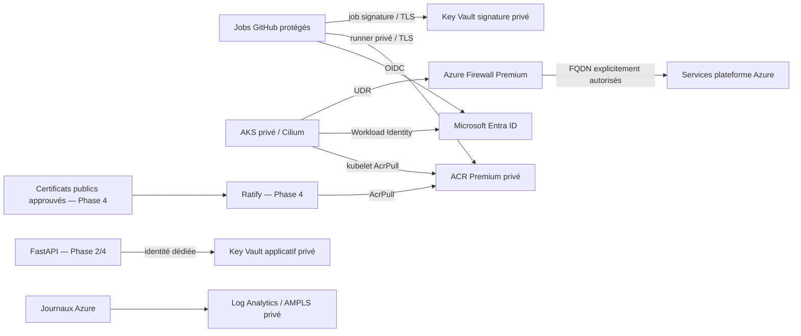

# Phase 1 — Socle Azure Zero Trust / DevSecOps

Code Terraform modulaire pour une application FastAPI sur AKS privé. Le socle prépare les étapes Docker, CI/CD et admission ; aucune application n'est déployée ici. Les valeurs d'exemple doivent être adaptées à la landing zone de l'entreprise et un déploiement de qualification doit précéder la production.

## Structure

```text
infra/
├── versions.tf                 # Provider verrouillé, backend Entra
├── main.tf                     # Composition, journaux et Azure Monitor Private Link
├── variables.tf
├── outputs.tf                  # Identifiants publics uniquement
├── terraform.tfvars.example
├── backend.hcl.example
├── .terraform.lock.hcl         # À versionner
├── modules/
│   ├── network/                # VNet, NSG, UDR, DNS privé, Firewall Premium
│   ├── services/               # ACR Premium, deux Key Vault et Private Endpoints
│   ├── aks/                    # AKS privé, Cilium, pools, identités et RBAC
│   └── identities/             # Fédération GitHub/AKS et droits de données
├── bootstrap-state/            # Backend Azure Storage privé, état indépendant
└── tests/offline.tftest.hcl     # Plans simulés et garde-fous de sécurité
```

Terraform >= 1.10 et < 2 ; AzureRM 4.81.0 exactement, avec fichier lock. Le pin permet une revue explicite des mises à jour du provider. Terraform 1.16.2 a été utilisé pour la validation locale. Une montée vers AzureRM 5 doit passer par une revue des changements de schéma et les mêmes contrôles.

## Architecture et limites de la Phase 1



L'API Kubernetes, ACR, les deux Key Vault et les accès clients aux journaux ont des endpoints privés. Aucune IP publique sur les nœuds, aucun compte admin ACR, aucune access policy Key Vault, aucune clé de compte pour accéder au state, aucun client secret ni certificat d'authentification CI.

Le réseau **n'est pas déconnecté d'Internet** : Entra, ARM, les dépendances AKS et Azure Policy sont autorisés à travers le pare-feu. Le FQDN tag `AzureKubernetesService` est maintenu par Microsoft ; les destinations Azure Policy et Entra sont ajoutées explicitement. Tous les autres flux Internet sont refusés par le pare-feu. La règle NSG autorisant HTTP/HTTPS vers `Internet` laisse ces flux parvenir au pare-feu via la route forcée ; elle ne crée pas de sortie directe. L'IP publique du pare-feu sert au SNAT uniquement, sans DNAT.

Les NSG autorisent les échanges node/node, node/pod et pod/pod requis par CNI Overlay. **Cilium activé ne signifie pas default-deny** : les NetworkPolicies, la restriction IMDS, les namespaces et les contrôles d'admission seront installés en Phase 4. Les applications ne doivent pas être mises en production avant cette étape. Les comptes de service doivent être protégés par RBAC pour empêcher l'usurpation de leur identité fédérée.

Les journaux de ressources utilisent les Diagnostic Settings Azure, sans agent de collecte dans AKS. Les requêtes et l'ingestion cliente publiques du workspace sont désactivées ; AMPLS permet un accès privé. Les Diagnostic Settings sont transmis sur un canal Microsoft privé indépendant de ces réglages. Container Insights, Defender for Containers, alertes/SIEM et collecte applicative restent à intégrer selon les besoins.

## Plan d'adressage

| Usage | Plage |
|---|---|
| VNet dédié | `10.40.0.0/16` |
| Pool système + endpoint API AKS géré par AKS | `10.40.0.0/23` |
| Pool applicatif | `10.40.4.0/22` |
| Private Endpoints ACR/KV/Monitor | `10.40.8.0/24` |
| Runners CI réservés | `10.40.9.0/24` |
| AzureFirewallSubnet | `10.40.10.0/26` |
| Pods Overlay | `10.244.0.0/16` |
| Services Kubernetes | `10.96.0.0/16`, DNS `10.96.0.10` |

Les CIDR sont centralisés dans `modules/network/main.tf` et `modules/aks/main.tf`. Vérifier tous les chevauchements avec le réseau d'entreprise, VPN, hub et futurs spokes avant l'application. Un changement de CIDR peut imposer de recréer le cluster.

Les zones DNS ACR et Key Vault incluent les enregistrements créés par les Private DNS Zone Groups, y compris les endpoints de données ACR. Le DNS du VNet pointe vers le proxy DNS du pare-feu, qui résout les zones privées liées au VNet. AKS gère son Private Endpoint de contrôle : on n'en crée pas un deuxième.

Les zones Azure Monitor partagées doivent être intégrées au DNS de la landing zone si celle-ci possède déjà un AMPLS. Ne pas créer plusieurs AMPLS pour des réseaux partageant le même DNS. Le hub existant du backend doit être connecté au réseau des runners avant leur activation, avec peering/VPN/ExpressRoute et transfert DNS adaptés. Ce socle crée un VNet autonome ; il ne modifie pas votre hub existant.

## Identités et moindre privilège

| Identité | Fédération | Accès |
|---|---|---|
| `build` | GitHub, environnement `build-production` | `AcrPush` sur le registre dédié |
| `sign` | GitHub, environnement `sign-production` | `AcrPush` pour les signatures OCI ; lire clé publique/certificat et signer dans le coffre dédié |
| `ratify` | AKS, SA `gatekeeper-system/ratify` | `AcrPull` uniquement ; aucun accès Key Vault |
| `app` | AKS, SA `fastapi/fastapi` | Aucun rôle de données tant qu'un besoin précis n'est pas défini |
| kubelet | Identité managée du pool | `AcrPull`, sans push ni accès aux coffres |
| contrôle AKS | Identité managée distincte | Actions réseau explicitement listées, DNS privé, assignation de l'identité kubelet |
| groupe exploitation | Entra + Azure RBAC | Accès aux credentials utilisateur et administration Kubernetes au scope du cluster |

Le registre est dédié à cette application et explicitement en `LegacyRegistryPermissions`. Les rôles `AcrPull`/`AcrPush` sont limités à ce registre. Si plusieurs applications partagent un ACR, passer à ABAC avec des conditions par repository, puis tester les pulls kubelet et les OCI referrers de signature. Ne pas changer seulement le mode ACR : `AcrPull` classique n'est pas honoré en mode ABAC.

Le rôle de signature est personnalisé : `keys/read`, `keys/sign/action`, `certificates/read`. Aucun déchiffrement, export de secret, création/suppression de clé, accès au coffre applicatif ou droit d'administration Azure. Le coffre de signature doit contenir uniquement la clé et le certificat de cette chaîne de livraison ; les droits s'appliquent au coffre pour permettre les rotations contrôlées.

Les rôles réseau du contrôle AKS sont définis par actions et affectés aux sous-réseaux AKS, au VNet pour lecture/join, à la route table AKS et au NSG AKS. La table de routage CI est distincte. Les opérations sur les routes et le NSG sont intrinsèquement sensibles et doivent être surveillées. AKS possède également les droits de gestion nécessaires dans son resource group de nœuds géré par le service ; ils ne doivent pas être attribués aux identités applicatives.

Le groupe exploitation doit être soumis à PIM/MFA et n'inclure que les opérateurs nécessaires. La CI de build/sign n'a aucun rôle d'administration du cluster. La CI de déploiement et ses droits namespace seront ajoutés en Phase 3/4 ; ne pas utiliser Cluster Admin pour un job applicatif.

Les environnements GitHub sont une partie de la frontière de confiance : créer ces environnements avec restrictions sur les branches/tags, protection de la configuration des workflows, CODEOWNERS et revue pour la signature production. Le subject OIDC exact ne distingue pas les branches quand un environnement est utilisé : les règles GitHub doivent assurer cette restriction. Ne jamais exécuter du code de PR non fiable dans un job disposant de l'identité de signature. Les noms d'environnements build/sign doivent être distincts.

## Prérequis plateforme

1. Abonnement Azure public, tenant et groupe Entra d'exploitation existants.
2. Disponibilité régionale des trois zones, des tailles VM, d'Azure Firewall Premium, d'ACR Premium et du stockage ZRS ; quotas suffisants pour six nœuds initiaux et les surges. Aucun tarif n'est estimé ici ; vérifier les coûts avant application.
3. Azure CLI et `kubelogin` sur le poste d'exploitation ; authentification utilisateur interactive/MFA pour le bootstrap, ou identité fédérée existante de la plateforme. Azure CLI n'est pas installé dans l'environnement utilisé pour générer ce livrable.
4. Providers enregistrés par la plateforme : `Microsoft.ContainerService`, `Microsoft.ContainerRegistry`, `Microsoft.Network`, `Microsoft.KeyVault`, `Microsoft.ManagedIdentity`, `Microsoft.OperationalInsights`, `Microsoft.Insights`, `Microsoft.Storage`, `Microsoft.Compute`, `Microsoft.Authorization`, `Microsoft.PolicyInsights`.
5. Pour provisionner : droits de gestion des ressources et création des role definitions/role assignments dans les scopes concernés. La création initiale du resource group et du node resource group doit être autorisée. Ne pas donner Owner à la CI de build/sign. Un éventuel pipeline Terraform doit avoir sa propre identité OIDC protégée ; ce code ne crée pas une identité capable de s'auto-administrer.
6. Pour le state : hub/réseau d'administration existant, subnet Private Endpoints et zone `privatelink.blob.core.windows.net` déjà liés/résolus. Le bootstrap n'ouvre pas temporairement le stockage à Internet.

## 1. Initialiser le state distant privé

L'état Terraform est une donnée sensible, même sans secrets applicatifs déclarés : les providers peuvent stocker des attributs calculés. Azure Storage désactive Shared Key, impose Entra, TLS et un Private Endpoint. Versioning et soft-delete protègent les erreurs ; `prevent_destroy` protège les suppressions via cette configuration Terraform. Cette protection n'empêche pas une suppression ARM manuelle : ajouter des contrôles plateforme/locks conformément à votre exploitation.

Depuis un poste autorisé connecté au hub, renseigner les fichiers d'exemple. `state_principal_ids` contient les **object IDs** des opérateurs et de l'éventuelle identité Terraform, pas les client IDs. Les droits Blob sont limités au conteneur `tfstate`. Les identités build/sign n'ont pas accès au state.

```powershell
Set-Location infra/bootstrap-state
Copy-Item terraform.tfvars.example terraform.tfvars
# Renseigner les IDs/noms dans terraform.tfvars.
az login --tenant <TENANT_ID>
az account set --subscription <SUBSCRIPTION_ID>
terraform init
terraform validate
terraform plan -out=bootstrap.tfplan
terraform apply bootstrap.tfplan
terraform output backend
```

Le premier state est local, sur le poste d'exploitation protégé. Migrer ensuite cet état dans un blob distinct de celui du socle :

```powershell
Copy-Item backend.tf.example backend.tf
Copy-Item backend.hcl.example backend.hcl.local
# Renseigner le nom du stockage ; key = bootstrap/production.tfstate.
terraform init -migrate-state -backend-config=backend.hcl.local
```

La propagation RBAC peut prendre plusieurs minutes : un 403 initial doit être diagnostiqué puis retenté sans réactiver Shared Key ni l'accès public. Vérifier que le backend contient l'état avant d'effacer les copies locales selon la politique de l'entreprise. Ne pas appliquer de politique d'immutabilité/WORM au blob actif : Terraform doit pouvoir le modifier et prendre un lease pour le verrouillage.

## 2. Déployer le socle

Depuis `infra/`, renseigner `terraform.tfvars` et `backend.hcl.local`. Choisir une **version Kubernetes GA exacte** actuellement disponible dans la région et compatible AzureLinux3 ; aucune version régionale n'est supposée par le fichier d'exemple.

```powershell
Set-Location ..
Copy-Item terraform.tfvars.example terraform.tfvars
Copy-Item backend.hcl.example backend.hcl.local
az aks get-versions --location westeurope --output table
# Remplacer REPLACE_WITH_SUPPORTED_GA_VERSION dans terraform.tfvars.
terraform init -backend-config=backend.hcl.local
terraform fmt -recursive -check
terraform validate
terraform test
terraform plan -out=production.tfplan
# Revoir le plan et les scopes RBAC avant l'application.
terraform apply production.tfplan
terraform output
```

Les identifiants d'abonnement, tenant et client sont publics ; aucun mot de passe n'est demandé. Pour GitHub Actions en Phase 3, `azure/login` utilisera `id-token: write`, l'identité build ou sign et son environnement exact. Terraform CI utilisera une **autre** identité avec `ARM_USE_OIDC=true`, `ARM_USE_AZUREAD=true`, `ARM_CLIENT_ID`, `ARM_TENANT_ID`, `ARM_SUBSCRIPTION_ID` et le mécanisme de jeton éphémère GitHub. Aucun `ARM_CLIENT_SECRET` ou `ARM_ACCESS_KEY`.

La version Kubernetes est ignorée par Terraform après la création pour éviter un downgrade après une mise à jour automatique. Pour une montée mineure via Terraform, retirer temporairement `kubernetes_version` de `ignore_changes` dans une PR dédiée, renseigner la nouvelle version et revoir le plan. La modification de la variable seule ne suffit pas.

Le sous-réseau CI est réservé, sans runner provisionné et sans autorisation Internet au pare-feu. Avant activation, la Phase 3 ajoutera un NSG CI, les destinations GitHub exactes nécessaires, les accès au backend hub et les sources de dépendances approuvées. Choisir des runners éphémères avec réseau privé ou une offre GitHub de runners intégrés au VNet. Un runner GitHub standard sur Internet ne peut pas pousser dans cet ACR privé. La registration/connexion de runners autonomes doit utiliser des jetons temporaires et une identité de contrôle appropriée, sans PAT stocké dans l'image.

Le pool système réserve les composants critiques ; le pool applicatif porte `workload=application:NoSchedule`. La Phase 4 devra fournir la toleration et le nodeSelector correspondants. Trois nœuds et trois zones constituent la base ; compléter avec replicas, topology spread constraints et PDB pour résister à une perte de zone. La version initiale est choisie explicitement ; le canal `patch` et `NodeImage` assurent ensuite les mises à jour dans les fenêtres UTC indiquées dans le code. Prévoir une procédure pour les montées de version mineure.

Les signatures et artefacts seront construits sur les runners privés puis poussés dans ACR. Ne pas employer `az acr build` sans avoir conçu et validé le réseau privé des agents ACR Tasks ; le bypass des services Azure reste désactivé.

## 3. Certificat de signature et admission : contrat des phases suivantes

Le coffre de signature est créé **vide**. La Phase 3 provisionnera un certificat de signature de code avec clé non exportable, idéalement RSA-HSM dans ce coffre Premium, chaîne approuvée et rotation/expiration gérées. La CI obtient un jeton Entra éphémère et demande à Key Vault de signer le digest via Notation. La clé privée ne quitte pas le coffre. Ne pas créer une clé privée locale pour l'importer dans Terraform et ne pas déclarer de ressource `azurerm_key_vault_secret` contenant un secret applicatif dans ce socle.

Ratify utilisera une copie des **certificats publics de confiance** approuvée et versionnée, montée en ConfigMap en Phase 4. Cette configuration évite les plugins Key Vault qui exigent la lecture de la partie secret pour obtenir la chaîne complète. La rotation de cette copie doit être déployée avant la nouvelle clé de signature, avec période de chevauchement et retrait contrôlé de l'ancienne confiance. Le job de build/sign ne doit pas pouvoir modifier ce trust store ou l'admission.

**Azure Policy activé ne bloque pas à lui seul les images non signées.** L'offre managée AKS Image Integrity reste une préversion documentée avec effet Audit uniquement. Ce socle ne l'active pas et ne prétend pas assurer un Deny par cette fonctionnalité. La Phase 4 devra installer et verrouiller Ratify/Gatekeeper, avec règles d'admission synchrones, refus en cas d'erreur de vérification, politique Notation stricte, identité du signataire attendue, référence d'image par digest et registre approuvé. Il faudra tester : image signée valide admise, non signée/altérée/autre signataire refusée, Ratify/ACR indisponible refusé et couverture des containers/initContainers/ephemeralContainers.

L'extension Azure Policy fournit une instance Gatekeeper gérée. Vérifier le support du fournisseur external data et la compatibilité avec la version Ratify retenue. Ne pas installer un deuxième Gatekeeper sur les mêmes CRD/webhooks ni modifier aveuglément la release gérée. Si la version gérée ne permet pas le fail-closed requis, choisir une intégration d'admission supportée et testée avant la mise en production. Le contrôle d'admission doit précéder le premier déploiement applicatif.

## 4. Recette après application réelle

Depuis le réseau privé autorisé, confirmer :

- DNS : ACR login/data endpoints, deux Key Vault, API AKS et Azure Monitor résolvent vers les IP privées attendues ; pas de résolution publique de secours.
- Réseau : une machine hors VNet ne peut pas joindre les data planes ; egress arbitraire refusé ; seules les destinations Azure requises passent ; absence de NAT/LB outbound alternatif.
- RBAC : kubelet et Ratify peuvent tirer une image, mais pas pousser ; build peut pousser sans signer ; sign peut signer sans lire les secrets applicatifs ; app ne peut accéder à aucune donnée par défaut.
- AKS : comptes locaux et Run Command désactivés ; nœuds Ready, CoreDNS/Cilium/Policy opérationnels, autoscaling et upgrade de qualification réussis.
- Exploitation : événements API, ACR, Key Vault et Firewall reçus dans Log Analytics via Diagnostic Settings ; logs consultables depuis le réseau privé par les opérateurs autorisés. Ajouter leurs rôles de lecture Azure Monitor selon votre modèle d'exploitation.

Connexion utilisateur, sans credentials admin permanents :

```powershell
az aks get-credentials --resource-group rg-ztprod --name aks-ztprod
kubelogin convert-kubeconfig -l azurecli
kubectl get nodes -o wide
kubectl get pods -n kube-system
kubectl get pods -n gatekeeper-system
```

Adapter les règles NSG si vous ajoutez un ingress privé : le socle ne publie aucun service et n'autorise aucune source métier entrante. Les contrôles non-root, seccomp, filesystem read-only, interdiction de privilèges/hostPath et NetworkPolicy default-deny seront livrés dans les phases Docker/Kubernetes.

## Validation effectuée et sources

Contrôles locaux : provider signé téléchargé, formatage, validation Terraform et trois plans simulés. Ces contrôles n'interrogent pas Azure, ne valident pas les quotas ni la disponibilité régionale et ne prouvent pas la connectivité ou la propagation RBAC. Aucun `apply` Azure n'a été exécuté dans cette session.

- [AKS : trafic sortant requis](https://learn.microsoft.com/en-us/azure/aks/outbound-rules-control-egress)
- [AKS : filtrage avec Azure Firewall](https://learn.microsoft.com/en-us/azure/aks/limit-egress-traffic)
- [Azure CNI Cilium](https://learn.microsoft.com/en-us/azure/aks/azure-cni-powered-by-cilium)
- [CNI Overlay : exigences NSG](https://learn.microsoft.com/en-us/azure/aks/concepts-network-azure-cni-overlay)
- [AKS privé et DNS](https://learn.microsoft.com/en-us/azure/aks/private-clusters)
- [Permissions des identités AKS](https://learn.microsoft.com/en-us/azure/aks/aks-service-permissions)
- [Notation et Azure Key Vault](https://learn.microsoft.com/en-us/azure/container-registry/container-registry-tutorial-sign-build-push)
- [Limites d'Image Integrity managé](https://learn.microsoft.com/en-us/azure/aks/image-integrity)
- [Vérification avec Ratify et Azure Policy](https://learn.microsoft.com/en-us/azure/security/container-secure-supply-chain/articles/validating-image-signatures-using-ratify-aks)
- [Azure Monitor : conception Private Link](https://learn.microsoft.com/en-us/azure/azure-monitor/logs/private-link-design)
- [Schéma AzureRM 4.81 — ACR](https://github.com/hashicorp/terraform-provider-azurerm/blob/v4.81.0/website/docs/r/container_registry.html.markdown)
